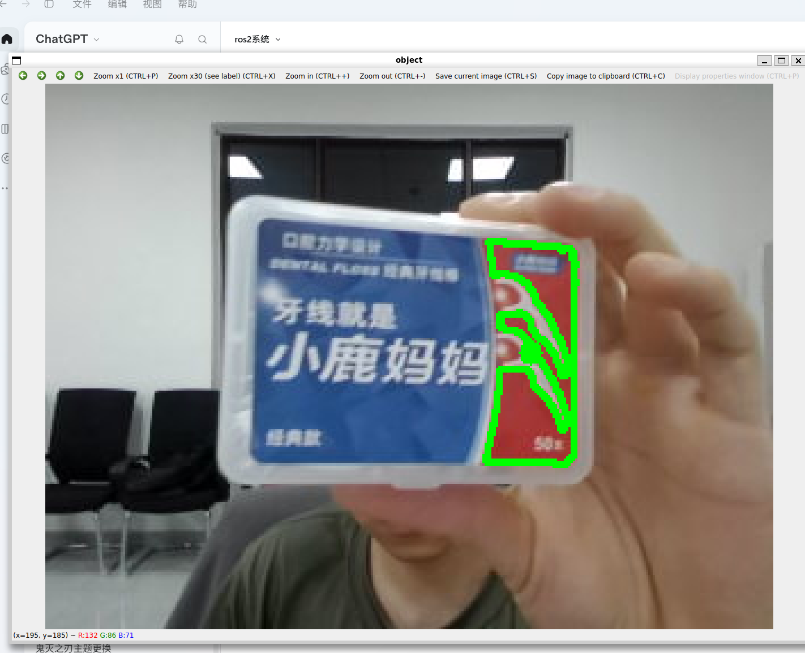

# 02-vision-red-detection

把笔记本**内置摄像头**通过 usbipd 转发进 WSL，用 ROS 2 节点做实时 **HSV 红色区域分割**。

实验编号：`ROS2-B-261122-001`　状态：定性验证通过

---

## 结果



红蓝双色包装右侧的红色区域被绿色轮廓框出，左侧蓝色区域未被标记。

- 采集测试：`读到画面: True`，帧尺寸 `(240, 320, 3)`
- 调参前出现过**圈到肤色**的误报，提高饱和度下限后消失
- ⚠️ 两张截图姿势、距离、遮挡都不同，**不能用来量化误报下降幅度**

---

## 链路

```
笔记本内置摄像头 (04f2:b758)
   ↓ usbipd attach --wsl
Windows ──────────────────→ WSL2 Ubuntu 24.04
                              ↓ modprobe uvcvideo
                            /dev/video0
                              ↓ cv2.VideoCapture(0, CAP_V4L2) + MJPG + 320×240
                            HSV 双段红色掩膜
                              ↓ 轮廓检测
                            ROS 2 节点画面 / 绿色框
```

---

## 关键参数

| 项目 | 值 |
|---|---|
| 采集后端 | `cv2.CAP_V4L2` |
| 像素格式 | **MJPG**（默认格式会 `select() timeout`） |
| 分辨率 | 320×240 |
| 红色 HSV 第一段 | `(0, 130, 128)` – `(10, 255, 255)` |
| 红色 HSV 第二段 | `(170, 130, 128)` – `(179, 255, 255)` |
| 合并方式 | `cv2.bitwise_or(red_low, red_high)` |

**为什么要两段**：红色在 OpenCV 的 HSV 色相环上跨越 0°/180° 接缝，只取一段会漏掉一半。

```python
hsv_img = cv2.cvtColor(image, cv2.COLOR_BGR2HSV)
red_low  = cv2.inRange(hsv_img, (0, 130, 128),   (10, 255, 255))
red_high = cv2.inRange(hsv_img, (170, 130, 128), (179, 255, 255))
mask_red = cv2.bitwise_or(red_low, red_high)
```

**调参要点**：只把最低饱和度从 `90` 提到 `130`，H 范围和最低亮度 `128` 保持不变。这样能压掉肤色（低饱和），代价是偏暗或不够鲜艳的红色会漏检。

---

## 复现步骤

### 1. Windows 侧转发 USB 设备

```powershell
usbipd list                       # 找到摄像头，记下 BUSID（如 2-6）
usbipd bind --busid 2-6           # 管理员，只需一次
usbipd attach --wsl --busid 2-6   # 每次接入都要执行
usbipd list                       # 状态应为 Attached
```

> `Shared` 不等于 `Attached`，只有 `Attached` 才真正接入 WSL。

### 2. Ubuntu 侧确认设备

```bash
ls -l /dev/video*
# 没有设备节点时：
sudo modprobe uvcvideo
ls -l /dev/video*

# 权限是 crw------- root root 时，临时授权当前用户
sudo chown "$USER" /dev/video0
```

> 不要用 `sudo` 启动 ROS 2 节点。

### 3. 运行节点

```bash
cd ~/guyue_ros2_ws
source /opt/ros/jazzy/setup.bash
source install/local_setup.bash

# 只有改过 src 下的源码才需要重新编译
colcon build --packages-select learning_node

ros2 run learning_node node_object_webcam
```

### 4. 用完归还设备

```powershell
usbipd detach --busid 2-6     # 把摄像头还给 Windows
```

接入期间 Windows 无法使用这组摄像头。

---

## 排错记录

完整过程见 [排错记录.md](排错记录.md)，共 8 条。最值得记的三条：

| 现象 | 结论 |
|---|---|
| 摄像头灯亮但不出图 | **灯亮 ≠ 收到帧**，必须实际读到 `frame is not None` |
| `Attached` 但 Ubuntu 没有设备 | 需要手动 `modprobe uvcvideo`；`lsusb` 没安装不代表设备未接入 |
| 改代码后 `SyntaxError` | 改 **`src/`** 里的源码，不要改 `install/` 里的副本（编译时会被覆盖） |

---

## 边界说明

这是一次**颜色分割**实验，不是目标识别：

| 做到了 | 没做 |
|---|---|
| 指定颜色区域的实时定位 | 物体类别判断 |
| 双段 H 范围覆盖色相接缝 | 准确率 / 召回率统计 |
| 定性改善（肤色误报消失） | 帧率测量 |
| — | 全光照、全距离、全材质验证 |

`S ≥ 130` 是本次有效的起点参数，不是通用最优值。

---

## 参考

- [古月居 ROS 2 教程 · learning_node](https://github.com/guyuehome/ros2_21_tutorials/blob/master/learning_node/learning_node/node_object_webcam.py)
- [微软 WSL USB 接入文档](https://learn.microsoft.com/zh-cn/windows/wsl/connect-usb)
- [OpenCV HSV 颜色空间](https://docs.opencv.org/4.13.0/df/d9d/tutorial_py_colorspaces.html)
